<picture>
  <source media="(max-width: 544px)" srcset="https://raw.githubusercontent.com/WenzelAddug/WenzelAddug/main/assets/banner-mobile.svg">
  
</picture>

## About me

<h3>English</h3>

I'm in my second year of DAW (Desarrollo de Aplicaciones Web) at IES Tetuán de las Victorias in Madrid. I came to the school in 2022 for the Grado Medio in SMR (systems and networks) and stayed for the Grado Superior.

What I enjoy most is taking a design from a Figma mockup to a page that works. This year I'm learning the server side with PHP and Java, so my plan is to work on both sides of a web app, starting from the frontend.

- Looking for a company for my internship (FFE) this school year, 2026-2027
- Three course certificates: Figma, Java and PowerShell (listed below)
- I speak Tagalog (native), English (C1) and Spanish (B1-B2)
- I practise algorithms on LeetCode with JavaScript

<h3>Español</h3>

Estudio 2º de DAW (Desarrollo de Aplicaciones Web) en el IES Tetuán de las Victorias, en Madrid. Llegué al centro en 2022 para hacer el Grado Medio de SMR y me quedé para el Grado Superior.

Lo que más me gusta es pasar un diseño de Figma a una web que funciona. Este curso estoy aprendiendo la parte del servidor con PHP y Java, así que mi idea es trabajar en las dos partes de una aplicación web, empezando por el frontend.

- Busco empresa para hacer las prácticas (FFE) este curso, 2026-2027
- Tres certificados de cursos: Figma, Java y PowerShell (están más abajo)
- Hablo tagalo (nativo), inglés (C1) y español (B1-B2)
- Practico algoritmos en LeetCode con JavaScript

## My path

<picture>
  <source media="(max-width: 544px)" srcset="https://raw.githubusercontent.com/WenzelAddug/WenzelAddug/main/assets/path-mobile.svg">
  
</picture>

## Tech stack

Red is what I already use. Yellow is what I'm learning this year.

**Frontend**  

**Backend and databases**  

**Design and tools**  

## Certificates

| Course | From | Date |
|---|---|---|
| Curso de Figma | OpenWebinars | October 2026 |
| Curso de Java Intermedio | Sololearn | May 2026 |
| Curso de PowerShell para Principiantes | OpenWebinars | November 2024 |

The certificates themselves are on my [LinkedIn profile](https://www.linkedin.com/in/wenzel-addug-827195289/details/certifications/).

## Projects

**[Mi Instituto](https://github.com/WenzelAddug/2-DAW-Dise-oInterface/tree/main/Mi%20Instituto%20Dise%C3%B1o%20Interface%20(Fase2))**, HTML and CSS  
School website designed in Figma and built for the Diseño de Interfaces Web module.

**[Server-side development (DWES)](https://github.com/WenzelAddug/2-DAW-Codigos-DWES-)**, PHP  
A mini forum with login, a fruit shop that keeps the order in the session, and a grades page with student and teacher roles.

**[Client-side development (DWEC)](https://github.com/WenzelAddug/2-DAW-DWEC)**, JavaScript  
A calculator, a dice roller, an image carousel and a Caesar cipher.

**[First-year programming](https://github.com/WenzelAddug/1-DAW-Codigos)**, Java  
Exceptions, collections, text files, a warehouse CRUD and unit tests with JUnit.

## This year

- Server side with PHP and Java, deploying web apps and more advanced JavaScript in the browser
- Practising algorithms on LeetCode with JavaScript

## Outside of code

Video games (eFootball, Valorant, NBA 2K), anime and football.

## Contact

Feel free to reach out. I'm always happy to connect and collaborate.
